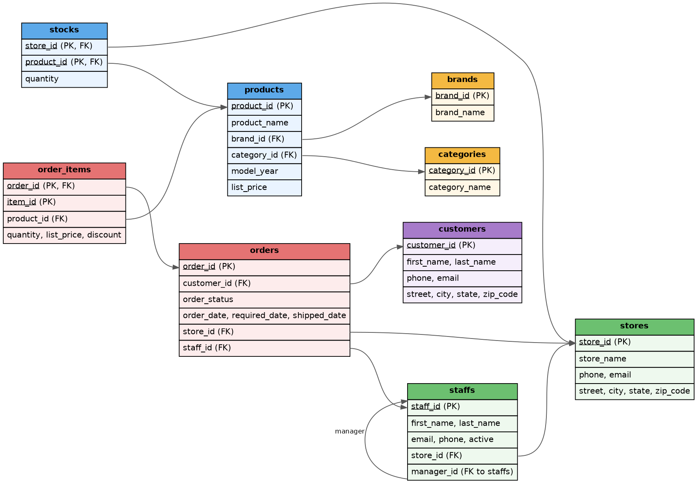

# MySQL Tutorial: Bike Store Dataset

## Roadmap

| File | Topics |
|---|---|
| `00_setup_and_dataset.md` | Database basics, keys, the bike_store structure, first commands |
| `01_select_filter_sort.md` | SELECT, DISTINCT, LIMIT, WHERE, ORDER BY, CASE |
| `02_functions_and_null.md` | String, number, date functions, NULL handling |
| `03_aggregation.md` | COUNT, SUM, AVG, GROUP BY, HAVING |
| `04_joins.md` | INNER, LEFT, RIGHT, CROSS, multi-table, self join |
| `05_union_and_subqueries.md` | UNION, subqueries, EXISTS, correlated subquery |
| `06_cte_and_window_functions.md` | WITH, recursive CTE, ROW_NUMBER, RANK, LAG, running total |
| `07_insert_update_delete.md` | INSERT, UPDATE, DELETE, transactions |
| `08_create_alter_constraints.md` | CREATE/ALTER TABLE, data types, constraints |
| `09_views_and_indexes.md` | Views, indexes, EXPLAIN |
| `10_routines_and_triggers.md` | Stored procedures, functions, triggers |
| `11_mini_project_and_practice.md` | Business reports + practice questions with answers |

First, run `bike_store_full.sql` to create the database. All these files use that database.

---

## 1. What is a database?

| Term | Meaning | Bike store example |
|---|---|---|
| **Database** | A container for related tables | `bike_store` |
| **Table** | Data in rows and columns, like an Excel sheet | `products` |
| **Row (record)** | A single entry | All details for one bike |
| **Column (field)** | A property with a fixed data type | `list_price` |
| **Schema** | The structure of tables and their columns | ER diagram below |

**SQL** (Structured Query Language) is the language we use to communicate with a database. **MySQL** is database software that understands SQL.

## 2. Keys: how tables are connected

Keeping everything in one table causes data to repeat. If every order included the customer's full address, a customer with 10 orders would have the address stored 10 times. Data is therefore split across tables and connected with **keys**.

- **Primary Key (PK):** A column that uniquely identifies each row. It cannot be NULL or duplicated, such as `customers.customer_id`.
- **Foreign Key (FK):** A column that points to a primary key in another table. For example, `orders.customer_id` identifies the customer for an order.
- **Composite Key:** Two or more columns together form a primary key. In `stocks`, the pair (`store_id`, `product_id`) is unique because a store has only one stock row for each product.
- **Self-reference:** A foreign key points to the same table. `staffs.manager_id` is the `staff_id` of another staff member.

## 3. Bike Store dataset



| Table | What it stores | Rows |
|---|---|---|
| `brands` | Bike brands (Trek, Surly...) | 9 |
| `categories` | Bike types (Road, Mountain...) | 7 |
| `products` | Each bike model and its price | 321 |
| `stores` | 3 shops (CA, NY, TX) | 3 |
| `staffs` | Store employees and their managers | 10 |
| `customers` | Customer names, contact details, and addresses | 1445 |
| `orders` | Each order's header: who placed it, when, and at which store | 1615 |
| `order_items` | The lines in each order (product and quantity) | 4722 |
| `stocks` | The quantity of each product at each store | 939 |

**Relationships in plain language:**
- A customer can have **many orders** (`customers` → `orders`).
- An order can contain **many items** (`orders` → `order_items`).
- Each item is a **product**, and each product has a brand and a category.
- Each order was handled by a **store** and a **staff member**.

### `order_status` codes

`orders.order_status` stores a number. In this dataset, the numbers mean:

| Code | Meaning |
|---|---|
| 1 | Pending |
| 2 | Processing |
| 3 | Rejected |
| 4 | Completed |

This mapping is not stored in a table. Remember it, or add labels later with `CASE WHEN`.

### Three things to know about the data

1. Most values in `customers.phone` are **NULL** (NULL means "no value"; it is not zero or empty text).
2. `orders.shipped_date` is NULL for orders that have not shipped yet.
3. `order_items` stores the price separately (`list_price`, along with `discount`). Product prices change in real stores, but amounts on past orders should not change, so the price at the time of the order is copied. In this dataset, `order_items.list_price` and `products.list_price` are the same.

## 4. First commands

Open a query tab in MySQL Workbench. Each statement ends with `;`; click ⚡ to run it.

List the databases:

```sql
SHOW DATABASES;
```

**Output:**

| Database |
|---|
| bike_store |
| information_schema |
| mysql |
| performance_schema |
| sys |

Select `bike_store` to use it. Every query you write after this will run against that database:

```sql
USE bike_store;
```

List the tables in this database:

```sql
SHOW TABLES;
```

**Output:**

| Tables_in_bike_store |
|---|
| brands |
| categories |
| customers |
| order_items |
| orders |
| products |
| staffs |
| stocks |
| stores |

Use `DESCRIBE` to view a table's structure (columns, data types, and keys):

```sql
DESCRIBE products;
```

**Output:**

| Field | Type | Null | Key | Default | Extra |
|---|---|---|---|---|---|
| product_id | int | NO | PRI | NULL |  |
| product_name | varchar(200) | YES |  | NULL |  |
| brand_id | int | YES | MUL | NULL |  |
| category_id | int | YES | MUL | NULL |  |
| model_year | int | YES |  | NULL |  |
| list_price | decimal(10,2) | YES |  | NULL |  |

Output columns:
- **Field:** the column name.
- **Type:** the data type. `int` is a whole number, `decimal(10,2)` allows 10 digits with 2 after the decimal point, and `varchar(200)` allows up to 200 characters of text.
- **Null:** `YES` means NULL is allowed.
- **Key:** `PRI` means primary key; `MUL` means a non-unique index on the column (here, a foreign key).

To see the table's original `CREATE TABLE` statement, use `SHOW CREATE TABLE`:

```sql
SHOW CREATE TABLE stocks;
```

Run a small first `SELECT` to view some data:

```sql
SELECT * FROM stores;
```

**Output:**

| store_id | store_name | phone | email | street | city | state | zip_code |
|---|---|---|---|---|---|---|---|
| 1 | Santa Cruz Bikes | (831) 476-4321 | santacruz@bikes.shop | 3700 Portola Drive | Santa Cruz | CA | 95060 |
| 2 | Baldwin Bikes | (516) 379-8888 | baldwin@bikes.shop | 4200 Chestnut Lane | Baldwin | NY | 11432 |
| 3 | Rowlett Bikes | (972) 530-5555 | rowlett@bikes.shop | 8000 Fairway Avenue | Rowlett | TX | 75088 |

The next file teaches `SELECT` in detail.

## Common mistakes

- **Forgetting `USE bike_store;`.** This causes `Error 1046: No database selected`. Alternatively, use the full table name: `bike_store.products`.
- **Forgetting the `;` at the end of a statement.** Workbench may run a query, but multiple statements can cause problems.
- **Case sensitivity.** SQL keywords (`SELECT`, `select`) are case-insensitive. Table names may be case-sensitive on Linux/Mac servers, so always use lowercase names such as `products`.

## Practice

1. How many columns are in the `categories` table, and which one is the primary key?
2. The primary key in `order_items` is composite. Which two columns make it up?
3. Which table does `staffs.manager_id` point to?

<details>
<summary>Answers</summary>

1. `DESCRIBE categories;` shows 2 columns (`category_id`, `category_name`). The primary key is `category_id`.
2. `order_id` and `item_id`.
3. The same `staffs` table (a self-reference). `manager_id` is another staff member's `staff_id`.

</details>
